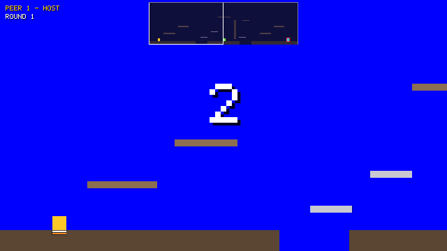

# 2D Game Engine

A lightweight 2D game engine written in **C++17** with peer-to-peer multiplayer via SDL2 and ZeroMQ.
Built as a graduate course project, now being actively developed toward professional standards.

The repo holds two engines:

- **Nova Engine** (`engine/`): the rewrite, built phase by phase along the roadmap below.
- **Legacy Engine** (`legacy/`): the original course-project engine, repaired and showcased with
  **Tag**, a networked platformer for 2–4 players. Its features will be ported into the Nova Engine.

<p align="center">  </p>

---

## Features

**Nova Engine**
- Fixed-timestep game loop, window, clock and logger
- Math library (Vec2, Rect)

**Legacy Engine**
- Entities with Properties (Gravity, Collide, Move, Control, DeathZone, SpawnPoint, SideBoundary)
- Event-driven architecture with game-defined Custom Events
- Timeline with pause, speed control and anchored timelines
- Peer-to-peer multiplayer over a ZeroMQ full mesh, with Host Migration
- Per-Peer Camera, proportional window scaling, and a built-in bitmap font

---

## Roadmap

- [x] Phase 1 — Foundation
      CMakeLists restructure → Math → Logger → Clock → Window → Bouncing rectangle demo <p align="center">  </p>
- [ ] Phase 2 — ECS Core
      Entity/Registry/ComponentPool → Transform + Sprite components → RenderSystem renders textures
- [ ] Phase 3 — Input & Events
      InputManager → ActionMap → EventBus → game responds to keyboard
- [ ] Phase 4 — Physics & Collision
      RigidBody + Collider → Box2D integration → CollisionSystem → CollisionEvent firing
- [ ] Phase 5 — Scene System
      Scene → SceneManager → SceneSerializer (JSON) → push/pop scenes
- [ ] Phase 6 — Lighting
      Light component → LightMap render target → LightingSystem compositor
- [ ] Phase 7 — Networking
      NetworkSync component → NetworkSystem → port existing ZMQ peer code
- [ ] Phase 9 — Tools
      Dear ImGui debug overlay → entity inspector → scene editor

---

## Project Structure
```
Nova2D/
├── engine/               # Nova Engine
│   ├── core/             #   Engine, Window, Clock, Logger
│   ├── math/             #   Math, Rect, Vec2
├── game/
│   ├── main.cpp          # Nova Engine demo game
├── tests/                # Nova Engine tests
├── legacy/               # Legacy Engine and its showcase
│   ├── engine/           #   Entities, Properties, events, Timeline, networking, rendering
│   ├── tag/              #   Tag: arena, Rounds, Tagging, Host role, HUD, nova2d_tag
│   ├── tests/            #   Legacy tests, using headless Peers
├── scripts/              # Setup scripts, and run_tag.sh to launch local Peers
├── docs/adr/             # Architecture decisions
├── CONTEXT.md            # Project glossary
├── CMakeLists.txt        # Cross-platform build system
├── .clang-format         # Code style (Google C++ style, 4-space indent)
└── .vscode/              # VS Code tasks, settings, extension recommendations
```

---

## Prerequisites

| Dependency | Version | macOS | Linux (apt) | Windows |
|---|---|---|---|---|
| C++ compiler | C++17+ | Xcode CLT: `xcode-select --install` | `sudo apt install g++` | MSVC 2019+ or MinGW |
| CMake | 3.20+ | `brew install cmake` | `sudo apt install cmake` | [cmake.org](https://cmake.org/download/) |
| SDL2 | 2.x | `brew install sdl2` | `sudo apt install libsdl2-dev` | `vcpkg install sdl2` |
| spdlog, Catch2 v3 | | `brew install spdlog catch2` | built by the setup script | `vcpkg install spdlog catch2` |
| ZeroMQ | 4.x | `brew install zeromq` | `sudo apt install libzmq3-dev` | `vcpkg install zeromq` |
| cppzmq | any | `brew install cppzmq` | `sudo apt install cppzmq-dev` | `vcpkg install cppzmq` |
| Boost (headers only) | 1.70+ | `brew install boost` | `sudo apt install libboost-dev` | `vcpkg install boost-property-tree` |

ZeroMQ, cppzmq and Boost are only needed for the Legacy Engine. The setup scripts install everything.

## Build & Run

**First time setup (run once):**
```bash
# macOS / Linux
./scripts/setup.sh

# Windows (PowerShell as Administrator)
powershell -ExecutionPolicy Bypass -File scripts/setup.ps1
```

**Every build after that:**
```bash
cmake -B build
cmake --build build -j$(nproc 2>/dev/null || sysctl -n hw.logicalcpu)
ctest --test-dir build          # Nova Engine and Legacy Engine tests
./build/bin/nova2d_game         # Nova Engine demo
```

The Legacy Engine, `nova2d_tag` and the legacy tests are built by default. To work on the Nova
Engine without ZeroMQ or Boost, turn them off:
```bash
cmake -B build -DNOVA2D_BUILD_LEGACY=OFF
```
CI builds with the legacy option off, so the Legacy Engine is built and tested locally only.

### VS Code

Open the repo folder — you'll be prompted to install recommended extensions.
- **Build:** `Cmd/Ctrl+Shift+P` → "Task: Run Tasks - Build"
- **Build & Run:** `Cmd/Ctrl+Shift+P` → "Task: Run Tasks - Run"

---

## Playing Tag

Tag is played by 2–4 Peers: each player runs their own `nova2d_tag`, and every Peer talks
directly to every other Peer.

### On one machine

```bash
./scripts/run_tag.sh 3      # opens 3 windows, Peers 1-3; Ctrl-C closes them all
```

Each window is one player. Click a window to control that player. You can also start Peers
yourself, in any order:
```bash
./build/bin/nova2d_tag --id 1 --players 3
./build/bin/nova2d_tag --id 2 --players 3
./build/bin/nova2d_tag --id 3 --players 3
```

### Across a LAN

Every Peer needs a different `--id`, the same `--players`, and the address of each other Peer.
Peer N listens on TCP port 5550 + N, so your firewall may ask to allow ports 5551–5554.
```bash
# on 192.168.1.10
./build/bin/nova2d_tag --id 1 --players 2 --peer 2=192.168.1.11
# on 192.168.1.11
./build/bin/nova2d_tag --id 2 --players 2 --peer 1=192.168.1.10
```
Peers without a `--peer` address are looked for on localhost. Run `nova2d_tag --help` for all
options.

### Controls

| Key | Action |
|---|---|
| ← → | Run |
| ↑ | Jump (while standing on something) |
| Double-tap a direction | Dash 200 px that way (10 s cooldown) |
| S + H together | Shrink to half size for 5 s (8 s cooldown) |
| P | Pause or unpause the game for everyone (Host only) |
| 1 / 2 / 3 | Game speed 2× / normal / 0.5× for everyone (Host only) |
| T | Toggle proportional scaling, so the arena fills a resized window |
| Esc | Quit |

The two bars under your player show when your dash and shrink are ready again.

### Rules

- Peers wait in the **Lobby** until `--players` of them are present, then a 3-2-1 countdown
  starts the first **Round**. Rounds last 120 seconds, followed by 5 seconds of results, then
  the next Round starts with whoever is still connected.
- One player is **It**, chosen at random at the start of each Round and frozen for 2 seconds so
  the others get a head start. It has a red outline.
- When It touches another player, that's a **Tagging**: the touched player becomes It.
  The new It can't tag straight back the player who tagged them for 2 seconds
  (**Tag-back Immunity**); that player flashes.
- The player who was It for the **least total time** wins the Round.
- Falling into a pit respawns you at your own spawn point after 1 second (It stays It).
- A dash fails if its landing spot is blocked. Only a shrunk player fits through the low gap
  under the central wall. You can't dash or shrink while frozen or Tag-back Immune.
- Peer 1 starts as the **Host**, which decides Taggings and owns the Round timer, the moving
  platforms and pause and speed. If the Host leaves or crashes, the remaining Peer with the
  lowest ID takes over (**Host Migration**). If It leaves, someone else becomes It, and if only
  one player is left the Round ends.
- A Peer that joins during a Round is a **Spectator** until the next Round.

The game's terms are defined in the glossary, [CONTEXT.md](CONTEXT.md). Why the network is a full
mesh with the Host as a role is recorded in
[ADR-0001](docs/adr/0001-full-mesh-with-host-role.md).

---

## Contributing

1. Fork the repo and create a feature branch: `git checkout -b feature/your-feature`
2. Follow the existing code style — clang-format runs automatically on save
3. Build with `-Wall` and ensure zero warnings before submitting a PR
4. Open a pull request with a clear description of what changed and why

---

## Credits

- [SDL2](https://www.libsdl.org/) — rendering and input
- [ZeroMQ](https://zeromq.org/) — peer-to-peer networking
- [Boost](https://www.boost.org/) — property tree (JSON messages)

Licensed under [GNU GPL v2](LICENSE).
